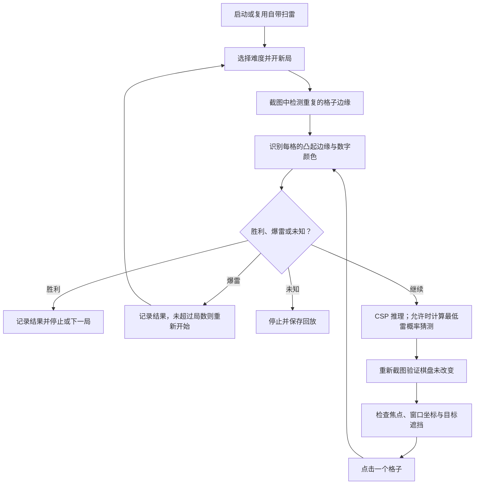
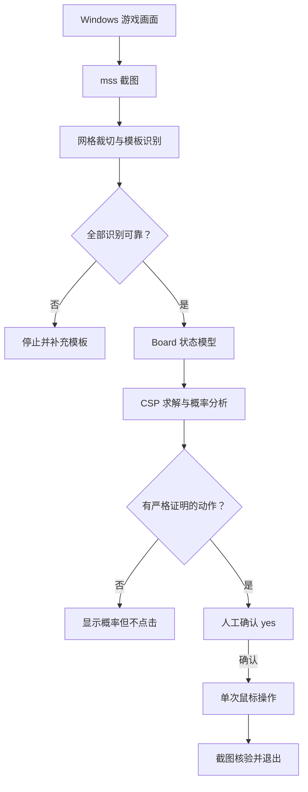

# Windows 经典扫雷视觉智能体：当前实现与设计记录

## v0.3 当前实现（2026-10-25）

当前已通过 Windows 真实扫雷初级、中级、高级的自动通关验证。入口为 `play.ps1` 或 `python -m minesweeper_agent play`。以下 v0.1 章节保留为原始设计记录，其中“人工确认”“尚无自动循环”等描述只适用于原有 `step` 模式。

v0.3 修复了大棋盘在 125% DPI 下白边偏移 1 像素导致漏行的问题；新增子集相减、等价格组合计数和枚举预算。自动模式最多处理 96 格相连未知区域，以 50 万节点及约 1.5 秒限制一次分析的枚举工作。超限不使用部分计数产生概率或证明，仍可保留独立的确定推理。

猜雷时先最小化精确雷概率，同概率候选才用空白区域展开的独立性估计排序。这个排序分数不作为实际雷概率或安全证明。`summary.json`/HTML 记录难度、尺寸、雷数、点击/猜测/插旗次数和耗时；JSONL 还记录每步求解耗时。启动脚本支持 `-Delay 0.1` 缩短点击后的等待，但保留每步截图重检。

### 自动运行的数据流



### 新增模块

| 文件 | 作用 |
| --- | --- |
| `play.ps1` | 安装/复用虚拟环境，启动有局数限制的自动演示，首次胜利停止 |
| `classic.py` | 从新局截图自动检测棋盘；识别彩色 XP 皮肤的未开格、旗帜、0～8、地雷 |
| `windows_game.py` | 按可执行文件路径绑定唯一窗口，管理启动/焦点/坐标，处理已识别的本地记录弹窗 |
| `autoplay.py` | 自动状态机、逐次重检、猜测开关、步数/局数上限、日志与 HTML 回放 |
| `tests/test_classic.py` | 真实 125% DPI 截图回归，包含数字 3 与红底地雷混淆的回归用例 |
| `tests/test_autoplay.py` | 猜测开关、未知/失败停止、点击无效停止、操作前棋盘变化停止、日志回放 |
| `tests/fixtures/` | 游戏客户区截图；不包含其他桌面内容 |

### 运行边界

- 识别和求解只使用截图。窗口 API 查询进程路径、坐标和焦点；不读取游戏地址空间、资源或地雷数组。记录弹窗仅读取其可见标题/控件文本。
- `play` 显式启动即允许该次有界自动执行；原有 `step` 仍逐次输入 `yes`。
- 自动模式只对完整的新局做自动标定，支持初级/中级/高级尺寸；默认初级。自动标定结果写 `data/classic-board.json`，不覆盖人工模式的 `data/board.json`。
- `--allow-guess` 才允许猜雷。首次开格利用自带 XP 扫雷的首击规则；之后先执行严格确定动作。自动模式相连未知格上限为 96，无法得到完整概率时不盲猜。
- 每次点击前再次截图并比较；每次点击后检查目标是否变化以及已打开格是否保持一致。未知状态、矛盾、窗口移动/失焦、遮挡和无效点击停止。
- 默认每局最多 600 次点击；可用 `--max-steps`、`--games` 和 `--stop-on-win` 控制。Esc/Ctrl+C/鼠标左上角可急停。
- 每次运行在 `data/runs/<时间>/` 保存 JSONL 事件、游戏截图、JSON 结果和 HTML 回放。程序结束后游戏窗口保留。
- 真实通关已验证环境：Windows、彩色 XP 扫雷、125% 缩放；初级 9×9/10 雷、中级 16×16/40 雷、高级 16×30/99 雷。其他皮肤和缩放尚未完成同等实机验收；猜雷可能失败，少量通关记录不代表稳定胜率。

### 验证记录

1. `python -m pytest -q`：38 项通过，包括求解器暴力枚举对照、48 格连通前沿的精确概率、部分枚举不得产生错误证明，以及三档难度真实截图/自动控制回归。
2. 直接运行 `play --allow-guess --games 5 --stop-on-win`：39 次点击通关，含 4 次概率猜测，胜利棋盘为 71 个已开格和 10 面旗。
3. 运行 `play.ps1 -Games 5`：20 次点击通关，除开局外全部为确定安全格；游戏显示 9 秒。破纪录及英雄榜弹窗处理后正常保存胜利截图并退出。
4. 关闭所有扫雷进程后再次运行脚本：自动启动成功；第一局 29 次点击后在 50% 猜测时爆雷，识别失败并重开；第二局 24 次点击通关，首次胜利后停止。启动阶段处理旧版游戏异步显示/激活；进入棋局后失焦仍立即停止。
5. 中级定位修复后的首次实测：143 次点击通关。高级首次实测：前三局猜测失败后重开，第四局 222 次点击通关。对应实际棋盘截图加入 `tests/fixtures/`。
6. 增强后的求解器回放上述胜局中的 367 个可见棋盘：确定安全格与雷格结论均与最终揭示的布局一致；该样本中单次分析最大耗时约 1.5 毫秒。该回放仅用于离线验证，运行中的 Agent 不读取最终布局。
7. 增强求解器后再次运行高级：第一局 331 次点击通关，包含 2 次猜测、96 次插旗，用时 120.88 秒。完整轨迹：`data/runs/20261025-214250-635263/`。
8. 增强求解器后再次运行中级：两局开局猜测失败后，第三局 98 次点击通关，包含 1 次猜测、2 次插旗，用时 34.29 秒。完整轨迹：`data/runs/20261025-214602-295407/`。

---

## v0.1 原始设计记录

> 项目名：**Minesweeper Visual Agent (MVA)**  
> 版本：**v0.1.0 / 需要 Windows 实机验证的 MVP**  
> 目标平台：**Windows 10/11，Python 3.10+**  
> 输入边界：**仅使用操作系统截图，不读取游戏进程、地址空间或内部 API**  
> 运行策略：**单步推理 → 人工审阅 → 明确确认 → 一次鼠标操作 → 截图核验**

## 1. 第一版目标

核心目标是验证一个可扩展到其他游戏的屏幕交互闭环：

1. 用户手动指定扫雷的棋盘矩形区域、行列数和可选的总雷数。
2. 从截图中识别每格是盖住、旗帜、数字 0～8、已暴露地雷或未知。
3. 将识别结果转为游戏无关的结构化状态和扫雷约束。
4. 使用确定性规则 + 小前沿 CSP 枚举找出**数学上必然正确**的动作。
5. 将动作显示给人类审核，只有输入完整 `yes` 才点击一次。
6. 点击后再次截图核验并退出，不自动进入下一步。

**非目标（v0.1）**：完全自动通关、自动识别任意皮肤/任意窗口、无监督 OCR/图像神经网络、强化学习、无解时自动猜测、多窗口并发或处理任意复杂前沿的性能优化。

## 2. 系统数据流



应用保留截图、感知、逻辑和控制的独立边界。换成 2048 时，可以保留截屏/坐标与点击控制层，替换识别器、状态规则和求解器。

## 3. 仓库目录结构

```text
minesweeper-visual-agent/
├── pyproject.toml                 # 包信息、依赖、命令入口和 pytest 配置
├── README.md                      # Windows 安装、运行教程、按键说明
├── PROJECT_STRUCTURE.md           # 本文档：架构、接口、迭代路线
├── .gitignore                     # 忽略环境及本地游戏截图模板
├── src/
│   └── minesweeper_agent/
│       ├── __init__.py             # 包版本
│       ├── __main__.py             # python -m minesweeper_agent 入口
│       ├── cli.py                  # calibrate / annotate / inspect / step
│       ├── model.py                # Rect / Settings / Board / Move
│       ├── geometry.py             # 网格坐标 ↔ 屏幕坐标
│       ├── capture.py              # DPI aware + mss 桌面截屏
│       ├── perception.py           # 用户标注模板、图像分类器
│       ├── solver.py               # 规则约束、连通分量、回溯、概率
│       └── controller.py           # 仅执行获确认的一次键鼠操作
├── tests/
│   ├── test_geometry.py           # 浮点格宽与坐标换算
│   ├── test_perception.py         # 合成图像模板识别
│   └── test_solver.py             # 逻辑、概率、矛盾、未知状态
└── data/                            # 首次运行生成，不分发、不入库
    ├── board.json                 # 用户选定的屏幕 ROI、行列和总雷数
    └── templates/<label>/*.png    # 当前扫雷皮肤的小格子样本
```

`data/` 是运行时目录，不在压缩包中预置游戏截图。任何示例和测试都可以通过合成图像产生，避免对真实显示器、鼠标和某个游戏安装版本的依赖。

## 4. 模块接口与责任划分

| 模块 | 关键接口 | 输入 → 输出 | 失败策略 |
| --- | --- | --- | --- |
| `capture.py` | `screenshot(rect)` | 屏幕区域 → BGR 图像、桌面矩形 | 抛出异常，禁止点击 |
| `geometry.py` | `cell_bounds`, `cell_center` | 网格 ROI/行列坐标 → 像素框/中心点 | 坐标越界抛异常 |
| `perception.py` | `TemplateRecognizer.read` | 网格图像 → `Board`、模板距离 | 低置信度记 `UNKNOWN` |
| `model.py` | `Board`, `Settings`, `Move` | 约束数据类 | 构造时校验维度/取值 |
| `solver.py` | `analyze(board, total_mines)` | `Board` → `Analysis` | 矛盾/识别未知 → `errors` |
| `controller.py` | `execute(move, settings)` | 已确认 `Move` → 单次鼠标操作 | 主屏越界或未知动作抛异常 |
| `cli.py` | `step` 等命令 | 调度整个流程，接受人工确认 | 默认不连续执行 |

### 4.1 状态表示

`Board` 使用二维行优先矩阵，行列坐标从 `0` 开始：

| 值 | 含义 | 允许解题器执行吗？ |
| --- | --- | --- |
| `-1` / `COVERED` | 未打开 | 可以进入约束求解 |
| `-2` / `FLAG` | 已插旗，**假定**下方是雷 | 可以，但若旗帜错误会破坏约束 |
| `-3` / `UNKNOWN` | 视觉不确定 | **绝不执行** |
| `-4` / `MINE` | 可见地雷、可能已失败 | **绝不执行** |
| `0..8` | 已揭开的数字 | 构建周围 8 邻域约束 |

`Settings` 包含 `rows`, `cols`, `rect`（桌面绝对像素坐标）和可选的 `total_mines`。如果没有可靠的总雷数，**不能**把未受数字约束的隐藏格当成已知概率。

### 4.2 求解器逻辑

给每个盖住的格子分配二元变量 `x[r,c] ∈ {0,1}`。数字 `n` 的约束为：

`sum(周围盖住格 x) = n - 周围旗帜数量`

处理流程：

1. 扫描所有已开数字，检测 `剩余地雷 < 0` 或 `剩余地雷 > 盖住格数` 的矛盾。
2. 迭代传播：剩余雷为 0 → 全安全；剩余雷数等于未知格数 → 全地雷。
3. 将重叠约束的未知格组成连通分量，对每个不超过 **18 格**的分量回溯枚举合法布局。
4. 没有指定总雷数时，输出该分量在**局部等权合法布局**模型下的概率；仅 `0/1` 被视为确定。
5. 指定总雷数时，对各分量合法布局计数进行卷积，再用组合数 `C(未受约束格数, 剩余雷数)` 对布局加权。计算各格严格的剩余布局比例。
6. 若全部有效布局都判为安全或地雷，产生 `Move`。确定安全格优先，之后才建议插旗。

**处理限制**：超过枚举上限时，仍保留简单传播结论，但停止复杂概率计算。存在视觉未知、已暴露地雷或不一致约束时不建议任何动作。不具备严格证明时只能打印概率参考，不执行风险点击。

### 4.3 屏幕与鼠标坐标

UI 标定选框是整块**棋盘格子区域**，不包含游戏窗口边框和 UI 控件。第 `(r,c)` 格使用四个边界，按网格比例取整：

```text
x0 = round(c       * board_width  / cols)
x1 = round((c + 1) * board_width  / cols)
y0 = round(r       * board_height / rows)
y1 = round((r + 1) * board_height / rows)
screen_click = (roi_left + (x0+x1)//2, roi_top + (y0+y1)//2)
```

这样即使屏幕缩放导致格宽不是整数像素，也不会把一列的误差累积到下一列。Windows 入口会尝试设置 DPI awareness。**第一版点击器只允许主显示器坐标**，避免 PyAutoGUI 多显示器差异引起误操作。

## 5. 界面与交互状态机

| 状态 | 人类操作 | 程序动作 | 转移条件 |
| --- | --- | --- | --- |
| `UNCALIBRATED` | 执行 `calibrate`，框选网格 | 保存位置、行列、雷数 | 合法 ROI → `TRAINING` |
| `TRAINING` | 执行 `annotate`，选格并标注 `c/0-8/f/m` | 存单格模板 | 可进入 `INSPECT` |
| `INSPECT` | 执行 `inspect` | 只读识别、显示棋盘 | 全部可信 → `READY` |
| `READY` | 执行 `step --dry-run` | 提议一步，不点击 | 经人工核对可进入 `APPROVAL` |
| `APPROVAL` | 执行 `step`，输入完整 `yes` | 再截图校验棋盘未变 | 不一致则停止；一致 → `ACTING` |
| `ACTING` | 无 | **一次**鼠标点击、截图校验 | 退出，重新进入 `READY` |
| `HALT` | 修复标注/校准/旗帜 | 不再点击 | 用户重新启动 |

交互原则：不要使用定时自动点击，不要在 `--dry-run` 调用鼠标。以后实现自动连续运行时，也应在现有的感知与验证接口外新建 orchestrator，而不是把 `while True` 塞到控制器中。

## 6. 快速运行

```powershell
py -3 -m venv .venv
.\.venv\Scripts\Activate.ps1
python -m pip install -e ".[dev]"
python -m pytest -q

# 启动并定位 9×9、10 雷的经典扫雷游戏后：
minesweeper-agent calibrate --rows 9 --cols 9 --mines 10
minesweeper-agent annotate

# 必要时手动揭开第一格，再 annotate 补充实际数字模板。
minesweeper-agent inspect
minesweeper-agent step --dry-run
minesweeper-agent step
```

**重要**：标注的样本必须来自真实游戏中的正确格子。识别器无法知道人类是否将数字 `2` 错标为 `3`；因此第一版务必人工检查 `inspect` 输出再执行 `step`。

## 7. 第一版验收标准

- [x] 已创建可安装的 Python 包、命令行入口、配置文件结构。
- [x] 已完成截图 ROI 标定、格子模板采样、网格分类接口。
- [x] 已完成确定性推理、分量枚举、可选总雷数加权概率。
- [x] 已实现人为输入 `yes` 后**只执行一个**鼠标点击。
- [x] 已加入再次截图核验、未知格/矛盾时停止的安全边界。
- [x] 已添加不依赖实际游戏的单元测试。
- [ ] **仍需 Windows 实机验证**：ROI、DPI、实际皮肤模板、鼠标聚焦、动态画面识别。
- [ ] **仍需真实棋局测试**：不同难度、缩放比例、长时间游戏和胜率统计。

## 8. 后续迭代顺序

| 版本 | 目标 | 核心增量 | 验收方式 |
| --- | --- | --- | --- |
| v0.2 | 视觉更稳 | 自动棋盘定位、经典皮肤模板包、OCR/颜色与模板交叉验证 | 各类数字标注集精度、误判率 |
| v0.3 | 更高效 | CSP 子集推理、前沿缓存、超大连通分量切分 | 更复杂局面处理时延 |
| v0.4 | 有风险决策 | 仅在人确认后执行最低雷概率的猜测，加入信息增益 | 固定种子多局胜率 |
| v0.5 | 自动执行 | 状态机、暂停/急停、自动重检、动作日志与异常检测 | 可控的批量游戏回放 |
| v1.0 | 通用游戏框架 | `GameAdapter` 接口、可插拔 Perception / Solver / Controller | 同一交互框架支持第二款游戏 |

推荐的未来抽象（**当前未实现**）：

```python
class GameAdapter:
    def observe(self, screenshot): ...
    def valid_actions(self, state): ...
    def transition_observed(self, previous, action, current): ...

class Policy:
    def propose(self, state): ...

class InputController:
    def execute_one(self, action): ...
```

对扫雷来说，确定性 CSP 是当前的 `Policy`；对 2048，可以换成 Expectimax；对需要连续控制的游戏，则改用决策频率更高的策略模型。
